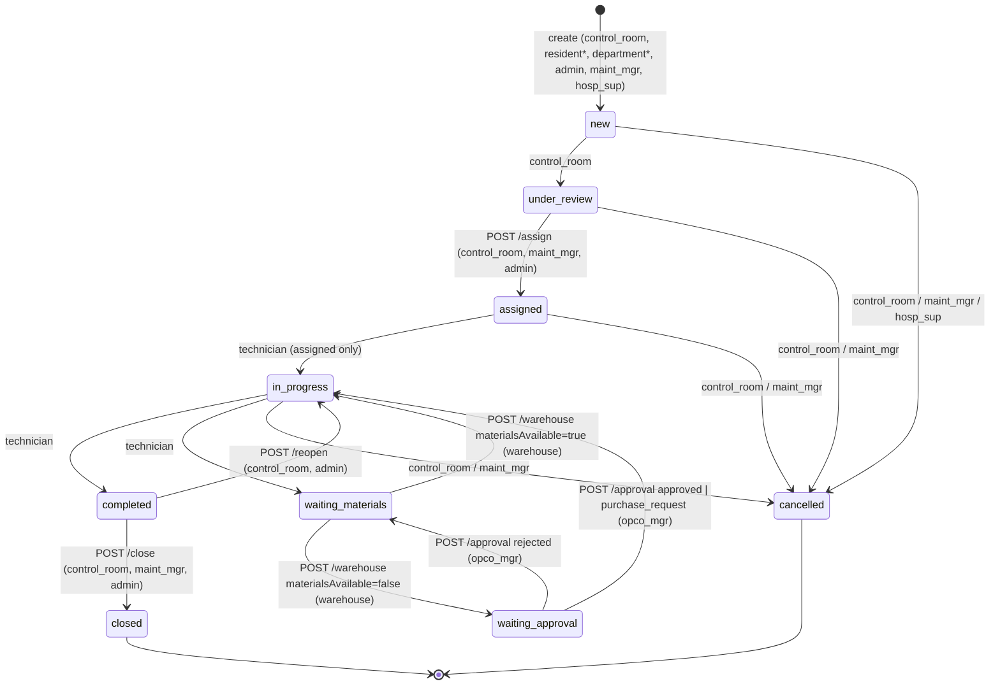

# SMMS — Multi-Role QA Test Plan

Status: **Plan only — nothing executed.** Results go in [test-results.md](test-results.md); evidence rules in [evidence/README.md](evidence/README.md). Project context: [../project-memory.md](../project-memory.md). Tooling: [../skills/README.md](../skills/README.md).

All behaviour below was derived from code review of branch `claude/smms-browser-test-setup` (paths relative to `Desktop/SMMS-FINAL/`). "Implemented" means *present in code*, not *verified in a browser*.

## 1. Scope

In scope: authentication, role navigation/dashboards, the work-order workflow (create → review → assign → repair → materials/approval → complete → close/reopen/cancel), warehouse decision, operating-company approval, attachments, notifications, ticket history (audit), API authorization, tenant/org scoping, RTL + desktop + iPhone-sized viewport, CLAUDE.md data rules.

Out of scope until implemented: inventory/stock management, procurement receipt, assets (DB tables exist in `scripts/V2__schema_migration.sql` but **no controller exposes them** — only `admin, auth, dashboard, import, maintenance-types, notifications, platform/tenants, work-orders` controllers exist under `backend-source/src/main/java/com/smms/controller/`).

## 2. Roles and planned test accounts

Usernames only — **never record passwords in QA documents.** Usernames are case-sensitive.

| Role (`UserRole`) | Account(s) | Status in target Codespace |
|---|---|---|
| system_admin | `admin`, `sysadmin` | exists (admin login confirmed by user) |
| region_supervisor | `Nasser` (Jazan cluster) | created by user in UI — not verified by Claude |
| hospital_supervisor | `Tareq` (KFCH-JZ) | created by user in UI — not verified by Claude |
| control_room | `cr.residential`, `cr.hospital`, `cr.it`, `cr.medical` | pending seeding in target Codespace; not yet verified |
| technician | `tech.residential`, `tech.hospital`, `tech.it`, `tech.medical` | pending seeding; not yet verified |
| maintenance_manager | `maint.manager` | pending seeding; not yet verified |
| electrical_manager | `elec.manager` | pending seeding; not yet verified |
| warehouse | `warehouse` | pending seeding; not yet verified |
| operating_company_manager | `opco.manager` | pending seeding; not yet verified |
| resident | `resident` (CR: residential) | pending seeding; not yet verified |
| department | `department` (CR: hospital, it, medical) | pending seeding; not yet verified |
| other | `other.user` (CR: hospital) | pending seeding; not yet verified |

Seed org data (`scripts/init.sql:272-296`): one region **JHC** → one center **KFCH-JZ** → four control rooms (residential, hospital, it, medical). One tenant ("default").

## 3. Workflow as implemented

Source: `backend-source/.../service/WorkflowEngine.java:19-56` (generic `/transition`), plus dedicated endpoints in `WorkOrderService.java` that **bypass the engine's role map** (assign `:118`, warehouse `:138`, approval `:165`, reopen `:204`). `system_admin` may perform any structurally valid engine transition (`WorkflowEngine.java:60-67`).

\* resident/department must hold explicit control-room access and match the CR type (`WorkOrderService.java:57-66, 340-350`): resident → residential; department → hospital/it/medical.

Other facts:
- Priority: `critical|high|medium|low`. SLA deadline set by DB trigger (4/8/24/48 h, `scripts/init.sql:226-243`); breach flag set every 5 min by `scheduler/SlaScheduler.java:28-36`. **There is no separate emergency workflow** — "emergency" = `priority=critical` + shorter SLA.
- Ticket number generated by DB trigger `WO-<year>-<CRTYPE>-<seq>` (`init.sql:249-266`).
- Every transition writes `ticket_history` (`WorkOrderService.java:307-318`); readable via `GET /api/work-orders/{id}/history`.
- Notifications: new ticket → control-room members; transitions → assignee; assign/reject → technician. `notifyApprover` is **empty** (`NotificationService.java:39-41`).
- Attachments: `POST/GET /api/work-orders/{id}/attachments`, extensions `jpg,jpeg,png,pdf,doc,docx`, ≤50 MB (`AttachmentService.java:27, 63-68`; `application-prod.yml:41,72`). No download endpoint found for `/uploads/`.
- Locking: any authenticated user can lock any ticket (`WorkOrderController.java:115`); only `/transition` honours the lock (`WorkOrderService.java:94`).

## 4. Permission matrix (backend, from code)

| Action / endpoint | sys_admin | region_sup | hosp_sup | control_room | technician | maint_mgr | elec_mgr | warehouse | opco_mgr | resident | department | other |
|---|---|---|---|---|---|---|---|---|---|---|---|---|
| Create WO `POST /work-orders` | ✓ | ✗ | ✓ | ✓ | ✗¹ | ✓ | ✗ | ✗ | ✗ | ✓² | ✓² | ✗¹ |
| List/view WOs | all tenant | all tenant³ | all tenant³ | all tenant³ | assigned only | all tenant | all tenant | all tenant | all tenant | all tenant³ | all tenant³ | all tenant³ |
| new→under_review | ✓ | | | ✓ | | | | | | | | |
| Assign | ✓ | | | ✓ | | ✓ | | | | | | |
| Start / complete / request materials | engine-valid | | | | ✓ (own) | | | | | | | |
| Warehouse decision | ✗⁴ | | | | | | | ✓ | | | | |
| Approval decision | ✗⁴ | | | | | | | | ✓ | | | |
| Close | ✓ | | | ✓ | | ✓ | | | | | | |
| Reopen | ✓ | | | ✓ | | | | | | | | |
| Cancel | ✓ | | new only | ✓ | | ✓ | | | | | | |
| Create users | ✓ | ✓ | ✓ | | | | | | | | | |
| Reset password | ✓ | | | | | | | | | | | |
| Regions create | ✓ | | | | | | | | | | | |
| Centers create | ✓ | ✓ | | | | | | | | | | |
| Management dashboard | ✓ | ✓ | ✓ | | | ✓ | ✓ | | ✓ | | | |

¹ Allowed by `@PreAuthorize` (`WorkOrderController.java:36`) but rejected by `validateSubmitterRole` (`WorkOrderService.java:340-350`) → 403. ² Needs CR access + matching CR type. ³ No region/center/requester scoping — only tenant filter (`WorkOrderService.java:257-273`, `TenantSecurityService.java:105-121`). ⁴ `@PreAuthorize` is role-specific; admin is not included.

## 5. Frontend navigation (from `frontend/src/components/layout/Sidebar.tsx:34-110`)

| Role | Landing (`login/page.tsx:49-51`) | Menu items |
|---|---|---|
| system_admin | /dashboard | dashboard, work-orders, approvals, users, regions, centers, control-rooms, reports, settings, config |
| region_supervisor | /dashboard | dashboard, work-orders, approvals, users, centers, control-rooms, reports, settings |
| hospital_supervisor | /dashboard | dashboard, work-orders, approvals, users, control-rooms, reports, settings |
| control_room | /dashboard | dashboard, work-orders, settings |
| technician | /my-tasks | my-tasks |
| maintenance_manager / electrical_manager | /dashboard | dashboard, work-orders, approvals, reports |
| warehouse | /dashboard (not in its menu) | work-orders |
| operating_company_manager | /dashboard | dashboard, approvals, reports, settings |
| resident / department | /new-request | new-request, settings (no page to track own requests) |
| other | /dashboard (forbidden API) | **none** |

## 6. Entry gate — contract smoke tests (run FIRST)

Code review found two likely API/UI contract mismatches that would block most scenarios. Verify before the campaign:

| QA ID | Check | Why |
|---|---|---|
| QA-050 | Submit a request from `/new-request` as `resident` | UI sends maintenance-type **name** (`"Electrical"`, `"Civil Works"`, `new-request/page.tsx:175`) as `subType`; backend enum is `electrical, civil, …` (`enums/SubType.java`), Jackson is case-sensitive → expected 400 |
| QA-051 | As `cr.residential`, move a `new` ticket to `under_review` in the UI | Only `NEW` has `@JsonProperty`; other `TicketStatus` constants serialize/deserialize as `UNDER_REVIEW` etc. (`enums/TicketStatus.java:5-15`) while the UI sends/compares lowercase |
| QA-052 | Open `/approvals` as `opco.manager` | Calls `GET /work-orders?status=waiting_approval` (`approvals/page.tsx:32`) → enum conversion of `waiting_approval` |
| QA-053 | Create via API, inspect response `ticketNumber`/`slaDeadline` | Trigger-generated columns are not re-read by Hibernate → likely `null` in create response and in "new ticket" notification text |

If QA-050/051 fail, stop and fix (with regression tests) before scenarios A–H.

## 7. Scenarios

Handoffs use only roles/transitions that exist. Each step is one QA ID; record the ticket number as "Request ref".

### A — Routine repair, no parts — **Implemented**
| QA ID | Actor | Step | Expected |
|---|---|---|---|
| QA-101 | resident | Submit residential request (priority medium) | 201, status new, ticket number `WO-YYYY-RESIDENTIAL-n` |
| QA-102 | cr.residential | new → under_review | history row added |
| QA-103 | cr.residential | Assign `tech.residential` | status assigned; tech notified |
| QA-104 | tech.residential | assigned → in_progress (my-tasks) | ok |
| QA-105 | tech.residential | in_progress → completed with tech report | completedDate set |
| QA-106 | cr.residential | completed → closed | closedAt ≥ createdAt; full history visible |

### B — Part available in warehouse — **Partially implemented**
Status handoff exists; **stock check and stock deduction do not exist** (no inventory API; `warehouseAction` only stores notes, `WorkOrderService.java:138-161`).
| QA ID | Actor | Step | Expected |
|---|---|---|---|
| QA-201 | department | Submit hospital request | new |
| QA-202 | cr.hospital | review + assign `tech.hospital` | assigned |
| QA-203 | tech.hospital | start, then in_progress → waiting_materials (note = part) | needsMaterials=true |
| QA-204 | warehouse | Decision materialsAvailable=true + notes | in_progress, warehouseNotes saved |
| QA-205 | tech.hospital → cr.hospital | complete → close | closed |
| GAP-B1 | — | Stock quantity check & deduction (CLAUDE.md §2) | **Not implemented** — record as gap, not FAIL of a feature |

### C — Part unavailable → approval / purchase — **Partially implemented**
`purchase_request` immediately returns ticket to in_progress (`WorkOrderService.java:175-178`); no procurement, no receipt, no inventory update; approver not notified.
| QA ID | Actor | Step | Expected |
|---|---|---|---|
| QA-301 | department | Submit IT request | new |
| QA-302 | cr.it / tech.it | review, assign, start, request materials | waiting_materials |
| QA-303 | warehouse | materialsAvailable=false | waiting_approval, needsMaterials, materialRequiredAt |
| QA-304 | opco.manager | Sees ticket in /approvals; notification? | ticket listed; **no notification expected (gap)** |
| QA-305 | opco.manager | Decision purchase_request | in_progress, approvedBy set |
| QA-306 | tech.it → cr.it | complete → close | closed |
| GAP-C1 | — | Procurement order, receipt, inventory update | **Not implemented** |

### D — Failed repair, rejection loop, reopen — **Implemented (reassignment partial)**
| QA ID | Actor | Step | Expected |
|---|---|---|---|
| QA-401 | (setup) | Ticket at waiting_approval via C steps | — |
| QA-402 | opco.manager | Decision rejected + reason | back to waiting_materials, rejectionReason, tech notified |
| QA-403 | warehouse | materialsAvailable=true | in_progress |
| QA-404 | tech | complete | completed |
| QA-405 | cr.* | Reopen with note | in_progress, reopenedCount=1, completedDate cleared |
| QA-406 | tech → cr.* | complete → close | closed |
| GAP-D1 | — | Reassign to another technician after assigned | No reassign path (assign only from under_review) |

### E — Emergency — **Partially implemented (priority only)**
| QA ID | Actor | Step | Expected |
|---|---|---|---|
| QA-501 | cr.medical | Create medical ticket priority=critical | slaDeadline ≈ created+4h |
| QA-502 | cr.medical / tech.medical | review, assign, complete, close | normal flow |
| QA-503 | (observe) | Leave a critical ticket open past SLA (or check flag logic via API on an existing overdue test ticket) | slaBreached=true within 5 min after deadline |
| GAP-E1 | — | Distinct escalation/notification for critical tickets | **Not implemented** |

### F — Rejected / returned + resubmit — **Partially implemented**
Only cancellation exists (terminal); no "return for information" and no resubmission.
| QA ID | Actor | Step | Expected |
|---|---|---|---|
| QA-601 | Tareq (hospital_supervisor) | Cancel a `new` ticket with reason | cancelled, rejectionReason saved |
| QA-602 | maint.manager | Cancel an `under_review` ticket | cancelled |
| QA-603 | department | Try to act on cancelled ticket | no transitions possible |
| GAP-F1 | — | Return-to-requester + resubmit | **Not implemented** |

### G — Resident housing — **Implemented, tracking gap**
| QA ID | Actor | Step | Expected |
|---|---|---|---|
| QA-701 | resident | Submit to residential CR (complex/building/unit on profile) | 201 |
| QA-702 | resident | Try to submit to hospital CR via API | 403 (`validateSubmitterRole`) |
| QA-703 | resident | Find own request status in UI | **No list page in menu** — record as gap/UX defect |
| QA-704 | resident | `GET /api/work-orders` via API | Expected per privacy: own only. Code returns **all tenant tickets** → defect candidate |

### H — Categories, attachments, validation, duplicates — **Mostly implemented**
| QA ID | Actor | Step | Expected |
|---|---|---|---|
| QA-801 | department | Submit to IT and medical CRs with each sub-type | ticket numbers carry CR type |
| QA-802 | department | Missing title / missing subType | 400 with clear message |
| QA-803 | department | Upload jpg + pdf attachment | 201, listed |
| QA-804 | department | Upload `.exe` / 51 MB file | rejected with message |
| QA-805 | any | `GET /attachments` after upload | returns list without user internals (raw entity is returned — `WorkOrderController.java:141`; check for 500 or leaked fields) |
| QA-806 | department | Double-click submit / same request twice | Documents behaviour: no duplicate detection exists in code |
| QA-807 | other.user | Try to submit | 403 (no menu, rejected by service) — confirm intended product behaviour |
| QA-808 | technician | Try to submit via API | 403 despite `@PreAuthorize` allowing it |

## 8. Authentication

| QA ID | Check |
|---|---|
| QA-001 | Valid login per role → correct landing page |
| QA-002 | Wrong password → 401, generic message |
| QA-003 | Wrong-case username (`nasser`) → 401 (case-sensitive) |
| QA-004 | Brute force: repeated failures trigger lockout (`security/BruteForceProtectionService.java`) |
| QA-005 | Expired/forged JWT → 401; logout clears token |
| QA-006 | Deactivated user (toggle active) cannot log in |

## 9. Navigation & dashboards

QA-010…QA-021: one per role — log in, record visible menu vs §5, open every menu item, confirm no 403/blank page. Known risks: `warehouse` lands on `/dashboard` but `/api/dashboard/*` excludes warehouse; `other` has no menu; `approvals` shown to roles that cannot decide (403 on decision).

## 10. API authorization (direct calls with another role's token)

UI hiding is not proof. Use curl/Playwright `request` with each token.
| QA ID | Call | Actor | Expected |
|---|---|---|---|
| QA-901 | `POST /work-orders/{id}/warehouse` | technician, control_room | 403 |
| QA-902 | `POST /work-orders/{id}/approval` | warehouse, system_admin | 403 |
| QA-903 | `GET /work-orders/{id}` of a ticket not assigned to them | technician | 404 (changed from 403 by the DEF-005 fix: out-of-scope tickets are hidden as not found) |
| QA-904 | `POST /admin/users` creating `system_admin` | hospital_supervisor | 403 (role hierarchy) |
| QA-905 | `POST /admin/users/{id}/reset-password` | hospital_supervisor | 403 |
| QA-906 | `POST /work-orders/{id}/lock` then transition by another user | resident locks, cr tries | documents lock-DoS behaviour |
| QA-907 | `POST /admin/regions` | region_supervisor | 403 |
| QA-908 | `GET /work-orders` | resident, department, other | record what is returned (tenant-wide today) |

## 11. Tenant / organisation isolation

Seed data has ONE region (JHC) containing ONE center (KFCH-JZ), so `Nasser` legitimately sees King Fahd data — that is **not** an isolation failure. Code only enforces **tenant** isolation for work orders; region/center scoping exists only for user listing by region_supervisor (`UserService.java:132-136`).
| QA ID | Check | Status |
|---|---|---|
| QA-951 | Create 2nd region + center (labelled `QA-TEST`) in same tenant; verify region/hospital supervisors of org 1 cannot read org 2 tickets via UI and API | **BLOCKED — needs user authorization to create test org records** |
| QA-952 | Create 2nd tenant via `/api/platform/tenants`; verify cross-tenant 404/403 for every endpoint | **BLOCKED — needs authorization** |
| QA-953 | control_room of residential reads/transitions an IT ticket (same center) | Expected by code: allowed — confirm intended |

## 12. Security & data rules (CLAUDE.md)

| QA ID | Check |
|---|---|
| QA-981 | Admin password reset sends `newPassword` as URL query (`frontend/src/lib/api.ts:76`, `UserController.java:85-90` `@RequestParam`) → appears in nginx access log. Verify with a disposable test account only; never a real password |
| QA-982 | Closing date never before opening date: `closedAt` is server time (`WorkOrderService.java:198`); also try `scheduledDate` earlier than creation via `/transition` (no validation in code) |
| QA-983 | Stock check before deduction — **not implemented** (no inventory API) |
| QA-984 | Status change + history are atomic (`@Transactional` class-level, `WorkOrderService.java:30`); parts not modelled |
| QA-985 | XSS: script tags in title/description are sanitized (`InputSanitizer`, `XssSanitizationFilter`) |
| QA-986 | Uploaded file names sanitized; path traversal (`../`) rejected |

## 13. UI, RTL and viewport

QA-971 desktop 1440×900 and QA-972 iPhone-sized 390×844 **emulation** (Playwright) for: login, dashboard, work-order list/detail, new-request, approvals, users. Check RTL alignment, Arabic labels, horizontal scroll, modal usability, form errors. Emulation ≠ physical iPhone; a physical-device check (QA-973) is done by the user on Safari and recorded separately.

## 14. Execution prerequisites, entry & exit criteria

Prerequisites:
1. User authorizes running `scripts/seed-test-accounts.sh` in the target Codespace; accounts then verified by login (not assumed from Claude's local copy).
2. Target environment reachable by the executing agent (Codespace port 80 is Private; Claude cannot reach it today — execution needs either the user running steps or an authorized, private access path).
3. Workflow: **Opus plans, Sonnet executes** (per CLAUDE.md); confirm model availability before starting.
4. No database reset/reseed. Test records prefixed `QA-` in title.

Entry: QA-050…053 executed; blocking contract defects fixed or explicitly accepted.
Exit: every QA ID has PASS/FAIL/BLOCKED/NOT TESTED with evidence; every FAIL has a defect entry; fixes have regression tests and retest results.

Evidence: `docs/qa/evidence/QA-###-<step>.png` — see [evidence/README.md](evidence/README.md).

## Updates after audit/fixes (2026-10-23)

**Facts.** Code fixes were committed after the audits (`35a0edf`, `c46cafb`, `b70ffed`) and verified against the **local sandbox API only** (Claude Code Remote cloud sandbox, ephemeral). They are **not yet verified in the user's Codespace**. The QA campaign has **not started**; no QA row below is PASS.

### New tests to add (execute in the target Codespace after seeding)

| New test | Expected |
|---|---|
| Token typ: use a refresh token as a bearer token on any API | 403 |
| Login lockout: 5+ failed logins for one user | HTTP 429 |
| Reset-password with JSON body | 204 |
| Reset-password with password in the query string | 400; password absent from nginx access logs |
| Self-update (user edits own profile) tries to change role/scope | role/scope unchanged |
| Generic `/transition` to `assigned` (and out of `waiting_approval`, and reopen) | 400 |
| Attachment upload (multipart) | 201 |
| Lowercase status/subType values end-to-end (scenario A) | accepted, filters and transitions work |
| Create-ticket response | contains `ticketNumber` |
| Resident lock attempt | 403 |

### Defect/finding status

| ID | Status |
|---|---|
| DEF-001, DEF-002, DEF-003, DEF-004, DEF-006 | **FIXED in code + verified on local sandbox API** (not yet in the user's Codespace) |
| SEC-002, SEC-003, SEC-004, SEC-006, SEC-008, SEC-009 | **FIXED in code + verified on local sandbox API** (not yet in the user's Codespace) |
| SEC-001, DB-001, DB-002, DB-003, DB-005, SEC-011 | Still open; need a user decision or migration (see [project-memory.md](../project-memory.md)) |

DEF-005 / SEC-005 (request visibility) is fixed under provisional role rules; the product owner should confirm them, especially the department rule and the `other` role. Isolation was verified on an isolated two-tenant throwaway database, not in the user's Codespace.
